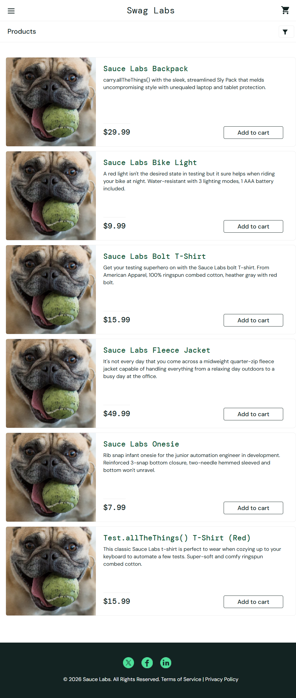

# BUG-01: All product images show the same dog photo for problem_user

| Field | Detail |
|---|---|
| Bug ID | BUG-01 |
| Reported by | Raesebe Marakalla |
| Date | (14/10/2026) |
| Requirement | REQ-02 Product Listing |
| Related test case | TC-LOGIN-15 (login as problem_user), TC-PROD-01 |
| Severity | Medium |
| Priority | Medium |
| Status | Open |

GitHub Issue: https://github.com/RaesebeMarakalla/qa-project-saucedemo/issues/1

## Environment
- URL: https://www.saucedemo.com/inventory.html
- Browser: Chrome (latest), Incognito
- OS: Windows
- User: problem_user / secret_sauce

## Steps to Reproduce
1. Open https://www.saucedemo.com
2. Log in with `problem_user` / `secret_sauce`
3. Look at the product images on the products page

## Expected Result
Each product shows its own correct image (for example the backpack image for Sauce Labs Backpack).

## Actual Result
All 6 products show the same dog photo, regardless of product name.

## Evidence

## Notes
`standard_user` shows the correct images, so the defect is specific to this user.
