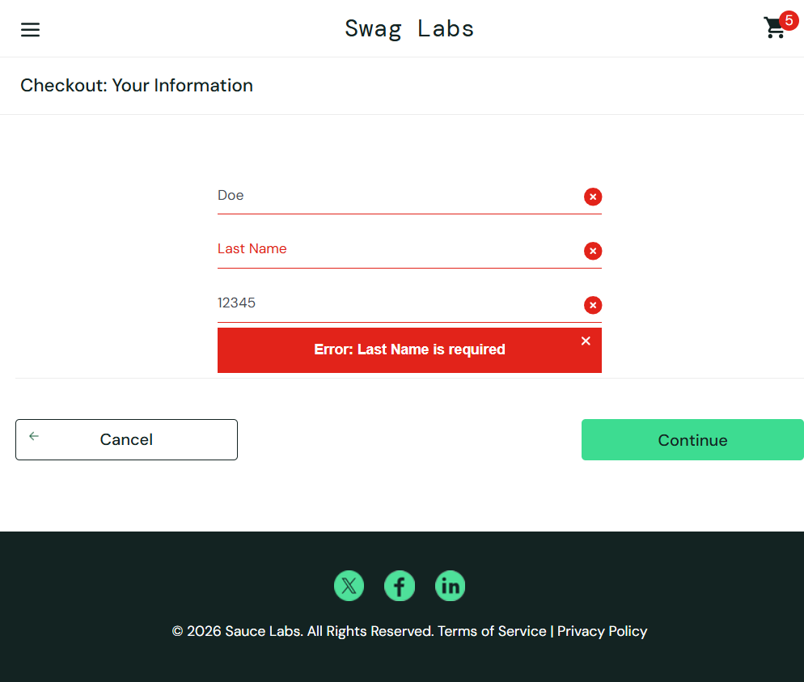
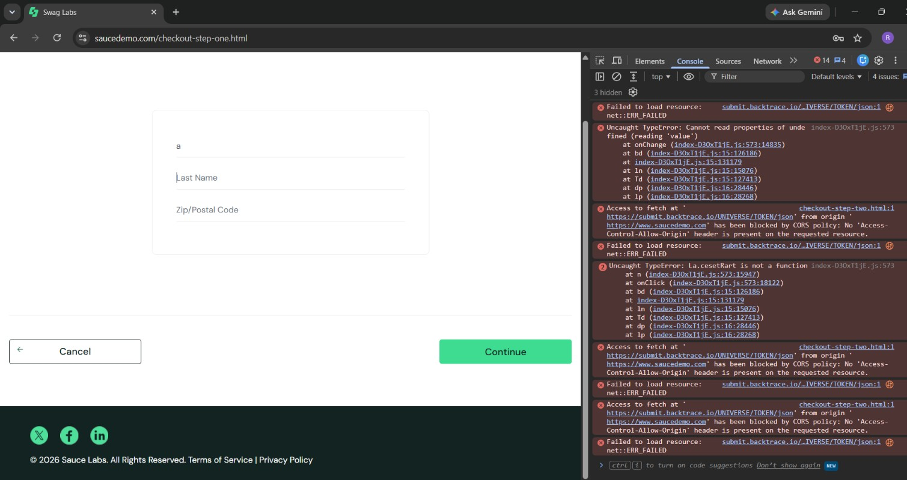

# BUG-02: Checkout form puts Last Name entry into First Name field for problem_user

| Field | Detail |
|---|---|
| Bug ID | BUG-02 |
| Reported by | Raesebe Marakalla |
| Date | (14/10/2026) |
| Requirement | REQ-05 Checkout |
| Related test case | TC-CHK-08 (all fields valid) |
| Severity | High |
| Priority | High |
| Status | Open |

GitHub Issue: https://github.com/raesebemarakalla/qa-project-saucedemo/issues/2

## Environment
- URL: https://www.saucedemo.com/checkout-step-one.html
- Browser: Chrome (latest), Incognito
- OS: Windows
- User: problem_user / secret_sauce

## Steps to Reproduce
1. Log in with `problem_user` / `secret_sauce`
2. Add any product to the cart
3. Click the cart icon, then click **Checkout**
4. Type `John` in First Name
5. Type `Doe` in Last Name
6. Type `12345` in Postal Code
7. Click **Continue**

## Expected Result
Each value stays in the field where it was typed, and the overview page opens.

## Actual Result
The First Name box shows "Doe", the Last Name box is empty, and the error "Error: Last Name is required" appears. The user cannot continue to the overview page with valid data.

## Evidence

## Notes
Verified: with `standard_user`, the same steps open the overview page. The defect is specific to `problem_user`.
Retest (Round 2): still reproduces. Console shows "Uncaught TypeError: Cannot read properties of undefined (reading 'value')" at onChange when typing in the form.