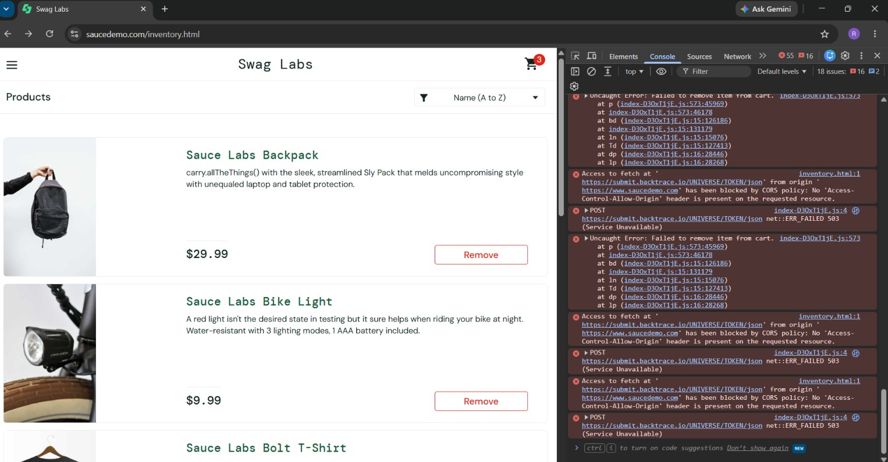

# BUG-04: Cart item removal fails for error_user

| Field | Detail |
|---|---|
| Bug ID | BUG-04 |
| Reported by | Raesebe Marakalla |
| Date | 15/10/2026 |
| Requirement | Cart management |
| Related test case | Cart removal test (ID not provided) |
| Severity | High |
| Priority | High |
| Status | Open |

## Environment
- URL: https://www.saucedemo.com/inventory.html
- User: `error_user` (inferred from the reported behavior; credentials not shown)
- Browser: Chrome (visible in screenshot)
- OS: Windows (visible in screenshot)

## Steps to Reproduce
1. Log in and add products to the cart until the cart badge shows 3.
2. On the products page, click **Remove** for Sauce Labs Backpack or Sauce Labs Bike Light.

## Expected Result
The selected product is removed from the cart, its button changes to **Add to cart**, and the cart badge decreases.

## Actual Result
The cart badge remains at 3 and both Sauce Labs Backpack and Sauce Labs Bike Light continue to display **Remove**. The browser console reports `Uncaught Error: Failed to remove item from cart.` from `index-D30xT1jE.js:573` after the removal attempts.

## Evidence

## Notes
The `submit.backtrace.io` CORS and 503 errors shown in the console are unrelated background noise and are not considered part of this defect.

Verified: with standard_user, Remove works normally. The defect is specific to error_user.
